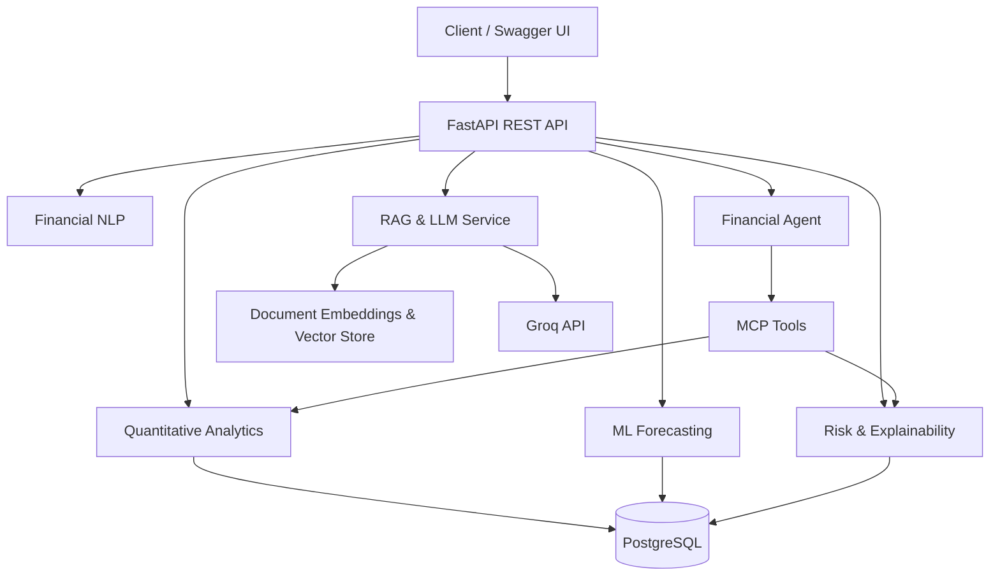

# Financial Intelligence & Risk Decision Support Platform

An end-to-end financial analytics and AI platform that combines quantitative market analysis, machine learning, risk intelligence, explainability, financial NLP, and retrieval-augmented generation (RAG) through a REST API.

> **Project status:** Local Docker deployment verified; portfolio release finalization in progress.

## Overview

Financial data is complex, noisy, and distributed across different sources. Predictive models alone are not enough: analysts also need interpretable forecasts, risk indicators, supporting evidence, and a way to investigate financial questions.

This project brings these capabilities together in a modular backend platform. It transforms stored market data into quantitative indicators, ML forecasts, risk assessments, and AI-assisted financial explanations.

The platform is designed as a reproducible, containerized application with a relational database, modular services, API endpoints, automated tests, and an extensible agent/MCP interface.

## Key Features

### Quantitative Analytics
- Historical market data ingestion and storage.
- Returns, annualized volatility, Sharpe and Sortino ratios.
- Maximum drawdown, Value at Risk (VaR), and expected shortfall.
- Technical indicators, including moving averages, RSI, MACD, and Bollinger Bands.
- Statistical anomaly detection.

### Machine Learning & Forecasting
- Comparative forecasting using XGBoost and other supported regression models.
- Forecast evaluation using MAE, RMSE, and directional accuracy.
- Forecast-driven risk intelligence and model comparison endpoints.

### Explainable AI
- Risk and prediction explanations designed to make model outputs easier to interpret.
- Integration of explainability methods and natural-language explanations.

### Financial NLP & RAG
- Financial text analysis and sentiment/event-oriented NLP.
- Custom document ingestion, chunking, embedding, and vector retrieval pipeline.
- Metadata-filtered retrieval and evidence-based LLM answer generation through Groq.
- Citation normalization and abstention behavior when supporting evidence is unavailable.
- RAG evaluation scripts and financial brief generation/validation workflows.

### Agent & MCP Integration
- An API-based financial analysis agent with controlled tool selection.
- Model Context Protocol (MCP) server exposing selected analytics and risk tools.
- Automated tests for MCP tool execution and a live protocol test script.

### Engineering & Reliability
- FastAPI REST API with OpenAPI/Swagger documentation.
- PostgreSQL, SQLAlchemy, and Alembic migrations.
- Docker Compose for the application and database.
- Centralized API error handling and configuration validation.
- Automated tests, Ruff linting, and formatting checks.

## Architecture



**Technology stack**

- **Language:** Python
- **API:** FastAPI, Uvicorn, Pydantic
- **Data & database:** Pandas, NumPy, SQLAlchemy, PostgreSQL, Alembic
- **Machine learning:** scikit-learn, XGBoost, LightGBM
- **NLP & LLM:** Transformers, Sentence Transformers, ChromaDB, Groq
- **Explainability:** SHAP and model interpretation utilities
- **Agent integration:** MCP
- **Quality & deployment:** Pytest, Ruff, Docker, Docker Compose

## API Endpoints

The application exposes the following API routes:

| Capability | Endpoint |
|---|---|
| Health check | `GET /api/v1/health` |
| Companies | `/api/v1/companies` |
| Market data ingestion | `/api/v1/market/ingest/{ticker}` |
| Market data | `/api/v1/market/{ticker}` |
| Quantitative analytics | `GET /api/v1/analytics/{ticker}/summary` |
| Forecast model comparison | `/api/v1/ml/{ticker}/compare` |
| Forecasting | `/api/v1/ml/{ticker}/forecast` |
| Financial NLP | `/api/v1/nlp/{ticker}/analyze` |
| Explainability | `/api/v1/intelligence/{ticker}/explain` |
| Risk intelligence | `/api/v1/intelligence/{ticker}/risk` |
| RAG indexing | `POST /api/v1/rag/index` |
| RAG retrieval | `POST /api/v1/rag/retrieve` |
| RAG answer generation | `POST /api/v1/rag/answer` |
| Agent analysis | `POST /api/v1/agent/analyze` |

Interactive API documentation is available at `/docs` when the application is running.

## Getting Started

### Prerequisites

- Python 3.12 or later
- Docker Desktop with Docker Compose
- Git
- A Groq API key for LLM answer generation

### 1. Clone the repository

```powershell
git clone <YOUR_GITHUB_REPOSITORY_URL>
cd <YOUR_PROJECT_DIRECTORY>
```

### 2. Configure environment variables

Create your local environment file from the example:

```powershell
Copy-Item .env.example .env
```

Update `.env` with your local configuration and Groq API key. Keep this file private; never commit secrets to Git.

### 3. Create and activate a Python environment

```powershell
py -3.12 -m venv .venv
.\.venv\Scripts\Activate.ps1
python -m pip install --upgrade pip
pip install -e ".[dev,ml,nlp,llm]"
```

Use a compatible Python version supported by the project dependencies.

### 4. Start PostgreSQL

```powershell
docker compose up -d postgres
```

### 5. Apply database migrations

With the virtual environment active and the host-side database URL configured in `.env`:

```powershell
python -m alembic upgrade head
```

### 6. Run the API locally

```powershell
uvicorn financial_ai.api.main:app --reload
```

Open `http://localhost:8000/docs` to explore the API.

### Run using Docker

After configuring `.env` and applying the database migrations, start the API container:

```powershell
docker compose up -d api
docker compose ps
docker compose logs --tail 100 api
```

Test the health endpoint:

```powershell
Invoke-RestMethod http://localhost:8000/api/v1/health
```

The API is exposed on port `8000`, and PostgreSQL is exposed on port `5432` for local development.

## Testing & Code Quality

Run the automated test suite:

```powershell
pytest -q
```

Check linting and formatting:

```powershell
ruff check .
ruff format --check .
```

The latest recorded local verification reported **95 passing tests**, successful Ruff checks, and successful Docker health, analytics, and risk endpoint requests.

These results reflect the tested development environment; they are not a guarantee of production readiness.

## Repository Structure

```text
.
├── src/financial_ai/
│   ├── agent/             # Financial analysis agent
│   ├── api/               # FastAPI application and routes
│   ├── config/            # Application settings
│   ├── db/                # Database models and sessions
│   ├── ml/                # Forecasting and ML services
│   ├── rag/               # Retrieval and generation pipeline
│   └── mcp_server.py      # MCP server
├── migrations/            # Alembic migrations
├── data/
│   └── rag/
│       ├── corpus/        # RAG source documents
│       └── evaluation/    # Evaluation inputs and outputs
├── scripts/               # Data generation and evaluation scripts
├── tests/                 # Automated tests
├── docs/                  # Stage and evaluation documentation
├── Dockerfile
├── docker-compose.yml
├── pyproject.toml
├── Makefile
└── .env.example
```

## Current Limitations & Roadmap

- Validate RAG indexing and retrieval across a representative set of financial questions; one recent AAPL retrieval smoke test returned zero evidence.
- Expand evaluation datasets and measure retrieval relevance, answer groundedness, citation correctness, and abstention quality.
- Add a reproducible end-to-end setup and integration test for a fresh environment.
- Review persistence, authentication, rate limiting, observability, and deployment security before exposing the service publicly.
- Evaluate hosting options only when needed; the current reference deployment is local Docker.

## Security Notes

- Never commit `.env`, API keys, passwords, database dumps, or other credentials.
- Keep generated vector-store databases and runtime artifacts out of source control unless explicitly needed as small, sanitized test fixtures.
- Use environment variables or a secrets manager for sensitive configuration.
- Do not expose a development instance directly to the public internet.

## Disclaimer

This project is intended for software engineering, machine learning, and financial analytics demonstration purposes. Its forecasts and risk measures are experimental outputs based on available historical data and model assumptions. They are not investment advice or a guarantee of future performance.

## Author

**Harshvardhan Shinde**

AI/ML Engineering | Financial Analytics | Explainable AI | RAG & LLM Systems

- GitHub: `<YOUR_GITHUB_PROFILE_URL>`
- LinkedIn: `<YOUR_LINKEDIN_PROFILE_URL>`
